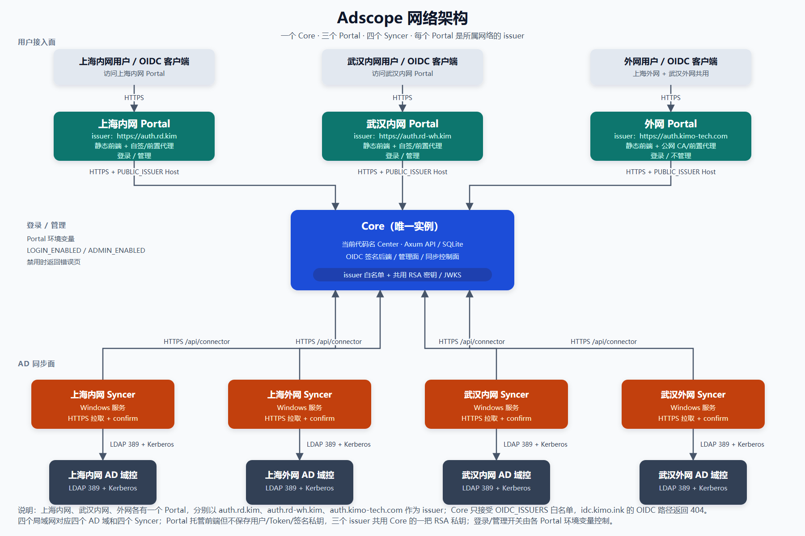

# Adscope 系统架构

## 定位与边界

Adscope 管理多个独立 Windows Server AD 域中的组织结构、用户、组和密码，并为预登记应用提供受限的 OIDC 统一登录。

系统只有一个 Core（当前代码名 Center）、三个 Portal（内网入口 A、内网入口 B、外网）和四个 Syncer（四个局域网、四个 AD 域，当前代码名 Connector）：

- Core 是账号、目录、凭据、OIDC 客户端和一次性授权码的唯一事实源，保存唯一 RSA 签名私钥，但不是 OIDC issuer。
- Portal 是每个网络的认证入口和 OIDC issuer，负责 TLS、静态前端、API/OIDC 转发和两组入口路径判断，不持有签名私钥。
- Syncer 是域内执行器，只把 Core 的当前期望状态写入本地 AD 域控，并直接访问 Core。

Web 是构建进 Portal 镜像的 Nuxt 静态应用，不单独保存业务状态。Core 只提供 API、OIDC 和数据面，不托管前端。

同步方向固定为 Center 到各 AD 域。域内人工修改不回写 Center，也不传播到其他域。没有统一事实源时，不允许让多个域或站点各自写本地主库后再自动合并。

## 网络架构

图 1：Adscope 网络架构



SVG 源文件：[adscope-network-architecture.svg](images/adscope-network-architecture.svg)。

图中的关键关系：

- 内网入口 A、内网入口 B、外网三个 Portal 都指向同一个 Core，不是三个 Core。
- 外网只有一个 Portal，由外网 A和外网 B共用。
- Portal 负责 TLS、静态前端、API/OIDC 转发和登录/管理两组路径判断，不保存用户、Token 或签名私钥。
- 管理面由内网 Portal 的 `ADMIN_ENABLED` 控制；外网 Portal 设置 `ADMIN_ENABLED=false`。Syncer 使用独立网络、端口或 ACL。
- Syncer 是安装在各 AD 域的 Windows 服务，不是容器，也不是 Portal。
- 每个 Syncer 只服务一个 AD 域，直接访问 Core，并主动连接本地域控。
- Core 不主动连接 AD 域，也不访问 Syncer 所在网络。
- 管理员从内网 Portal 访问 `/admin` 页面和 `/api/admin/*`；页面由 Portal 提供，API 转发到 Core。如果通过 VPN 接入，VPN 只是进入内网的路径，不是额外管理入口。

### 域名、证书与 issuer

三个 Portal 的公开域名和证书相互独立，不要求同名，也不共享同一张证书：

| Portal | issuer | 证书 | 管理入口 |
| --- | --- | --- | --- |
| 内网入口 A | `https://auth-a.example.com` | 内部 CA、自签或前置代理，SAN 含 issuer 域名 | 开启 |
| 内网入口 B | `https://auth-b.example.com` | 内部 CA、自签或前置代理，SAN 含 issuer 域名 | 开启 |
| 外网 | `https://auth-c.example.com` | 公网 CA 或前置代理，SAN 含 issuer 域名 | 关闭 |

每个 Portal 的公开域名就是所属网络的 OIDC issuer。Core 从 `OIDC_ISSUERS` 读取三个 issuer 的白名单，按 Portal 覆盖后的 Host 选择当前 issuer；`core.example.com` 不是 issuer，直接访问其 OIDC 路径返回 `404`。

三个 Portal 共用 Core 的一把 RSA 私钥和同一份 JWKS，OIDC 客户端记录保持全局、不绑定 issuer；依赖方按所属网络选择 Portal。授权码和 access token 绑定签发时的 issuer，跨 Portal 不能兑换或调用 UserInfo。

Portal 可以自己终止 TLS，也可以由前置反向代理终止后使用 HTTP 监听。只配置一个 TLS 文件时启动失败；HTTP 监听只能暴露在本机回环或受信网络。

内网用户访问内网 Portal 时，浏览器必须信任内部 CA 或自签证书，不能关闭 TLS 校验；外网客户端使用系统信任的公网 CA。三个 Portal 的 `adscope_sso` Cookie 都是 host-only，不共享登录态。

四个 Syncer 直接访问 `https://core.example.com` 的同步控制面，不经过 Portal 的 OIDC 路由，也不使用 issuer。

### 登录与管理开关

每个 Portal 是独立部署单元，各自读取两个环境变量。环境变量天然按 Portal 隔离，Core 不识别站点来源。

| 变量 | `false` 时拦截 | `false` 时仍可用 |
| --- | --- | --- |
| `LOGIN_ENABLED` | `/login`、`/authorize`、`/oauth2/authorize`、`/api/auth/login`、`/api/oauth2/authorize/context` | Discovery、JWKS、Token、UserInfo、`/api/me/*`、退出登录 |
| `ADMIN_ENABLED` | `/admin`、`/admin/*`、`/api/admin`、`/api/admin/*` | 用户登录、Token、UserInfo、Syncer 同步 |

- Portal 命中禁用路由时直接返回 `403`：浏览器路径返回 HTML 错误页，API 路径返回 JSON 错误，不转发给 Core。
- Portal 只对这两组路径做判断；其他 API/OIDC 路径转发给 Core，其余路径返回前端静态文件。
- 内网入口 A、内网入口 B Portal 设置 `LOGIN_ENABLED=true`、`ADMIN_ENABLED=true`。
- 外网 Portal 设置 `ADMIN_ENABLED=false`。
- `LOGIN_ENABLED=false` 只停止新的登录，不撤销已签发 Token 或依赖方本地会话。
- `ADMIN_ENABLED=false` 只停止管理面访问，不影响用户登录和 Connector 同步。
- Core 不参与开关判断。
- Portal 在返回前端或转发 API 前判断这两组路径；只能整站开关的实现无法独立控制登录和管理。

`adscope-gateway` 是仓库内的 Rust crate，用 axum/axum-server 处理 HTTP/TLS，用 reqwest 流式转发，不依赖 nginx/Caddy。

### Portal 安全边界

- Portal 如果终止 TLS，会看到密码、Cookie、client secret 和 Token 响应，只部署在受控主机上。
- Portal 不记录 Authorization、Cookie、授权码、Token 响应正文或完整请求体。
- Portal 不修改 `iss`、`sub`、`aud`、`nonce` 或签名，不持有 OIDC 签名私钥，不签发本地 Token。
- Portal 到 Core 走受信网络；Core 故障时，Portal 通常表现为连接失败或 502/503，不能本地兜底签发 Token。

## 部署单元与职责

| 单元 | 主要职责 | 明确不承担 |
| --- | --- | --- |
| Core（`adscope-center`） | HTTP API、用户登录、管理会话、OIDC Provider、密码保护、同步控制面、SQLite | 域控写入、TLS 证书管理、前端托管、多主复制 |
| Syncer（`adscope-connector`，Windows 服务） | 配置、本地 state、HTTP 拉取、LDAP 执行、运行日志 | 业务事实源、用户目录、OIDC 签发 |
| Web | Nuxt 静态前端，构建进 Portal 镜像 | 独立业务状态、独立 API |
| Portal（`adscope-gateway`） | TLS 终止或 HTTP 监听、静态前端、API/OIDC 转发、Host 覆盖、入口开关 | OIDC 签名、身份目录、Token 存储 |

Core 当前按单实例部署。SQLite 文件位于进程工作目录的 `data/adscope.db`，不支持多个 Core 副本共享同一文件并发写入。

## 代码边界

| 仓库内 Crate 或目录 | 职责 |
| --- | --- |
| `adscope-protocol` | 同步对象、请求响应、目录执行计划和共享数据结构 |
| `adscope-store` | 数据库模型、Repository、revision、OAuth 客户端和授权码持久化 |
| `adscope-center` | Center API、认证、OIDC、管理面、密码处理和同步控制面 |
| `adscope-connector` | Windows 服务、配置、本地 state、HTTP 客户端和域控执行 |
| `adscope-gateway` | Portal 的 TLS/HTTP 监听、静态前端托管、API/OIDC 转发、Host 覆盖和入口开关 |
| `gateway/web` | Nuxt 页面源码 |
| `gateway/static` | Portal 镜像内置的静态构建产物 |

`adscope-gateway` 用 axum/axum-server 处理 HTTP 或 TLS，用 reqwest 流式转发 `/api/*`、`/oauth2/*`、`/.well-known/*`，其余路径返回 `gateway/static` 的静态构建产物。它不实现 OIDC 签名、不保存用户/Token/私钥；Core 不托管前端。

中心服务内部按职责分为：

- `routes.rs`：普通用户登录、自助接口、Connector 同步和 API 总路由。
- `routes/admin.rs`：域、OU、用户、组、密码重置和同步状态。
- `routes/management_session.rs`：部署级管理凭证到浏览器会话的转换。
- `routes/oauth_clients.rs`：OIDC 客户端管理。
- `oidc/`：issuer 配置、JWT/JWKS、授权参数校验和协议端点。
- `password/`：密码 verifier 和可逆密码材料保护。
- `session.rs`：用户会话、管理会话和 CSRF 的 HMAC 签发。
- `state.rs`：Repository、密码提供者、会话发行器和 OIDC 服务的组装。

## 身份与信任边界

`employee_id` 是跨域人员主键，由 Center 分配并保持稳定。OIDC 的 `sub` 直接使用 `employee_id`，不做 pairwise。`username`、邮箱、显示名和工号属性都不是跨域人员主键。

系统使用五类互不替代的凭据：

- 普通用户 Bearer token：只用于 `/api/me/*`。
- `adscope_sso` Cookie：只用于浏览器 OIDC 授权流程。
- `adscope_management` Cookie：只用于管理面，写操作还需要 CSRF 请求头。
- Connector key：按域绑定，只用于 `/api/connector/*`。
- OIDC ID Token 和 access token：ID Token 用于依赖方确认人员，access token 只用于 `/oauth2/userinfo`。

管理面没有管理员账号、角色或审批流。部署级 `MANAGEMENT_TOKEN` 只用于建立 8 小时管理会话，浏览器不持久化该 token。

OIDC 客户端由管理员预先登记，不接受动态注册。Web 客户端是 confidential client，使用 `client_secret_basic`；Desktop 客户端是 public client，只接受 loopback redirect，不持有 secret。

## 核心流程

### 目录与凭据同步

Center 在同一个事务中分配 revision，并把 OU、用户、组、组成员或凭据写入当前事实表。Connector 每轮执行：

```text
读取本地 applied revisions
→ POST /api/connector/sync
→ 执行目录批次
→ 目录成功后 POST /api/connector/confirm
→ 执行凭据批次
→ 凭据成功后 POST /api/connector/confirm
→ confirm accepted 后写本地 state
→ 等待下一轮
```

目录和凭据使用独立 revision，互不阻塞。批次只能确认已经完整执行的目标 revision；失败不推进进度。系统保存当前状态，不保存变更日志、旧密码或历史事件。

### 用户自助

用户使用 Center 用户名和密码登录，成功后得到短期 HMAC Bearer token，同时设置 `adscope_sso` Cookie。自助接口只允许查看本人资料、修改 `email`、`mobile`、`telephone` 和修改本人密码。

### 管理会话

管理员提交部署级管理凭证后，Center 签发独立的管理 Cookie 和随机 CSRF nonce。页面刷新通过会话查询恢复状态；所有写操作同时校验 Cookie 和 CSRF 请求头。Center 不保存管理会话记录。

### OIDC 统一登录

Core 只支持 Authorization Code + PKCE S256：

1. 依赖方使用所属 Portal 的 issuer 和预登记 `client_id`、精确 `redirect_uri`、`state`、`nonce` 和 `code_challenge` 导航到 `/oauth2/authorize`。
2. Portal 用 `PUBLIC_ISSUER` 覆盖 Host 后转发到 Core；浏览器没有有效 SSO Cookie 时先登录，已有 Cookie 时直接进入确认页。
3. 用户确认后，Core 按当前 issuer 签发 120 秒有效的一次性授权码。
4. 依赖方调用 `/oauth2/token`，提交授权码和 PKCE verifier；Web 客户端同时使用 Basic client secret。
5. Core 按当前 issuer 签发 5 分钟有效的 ID Token 和 access token。ID Token 的 `sub` 是 `employee_id`，`aud` 是客户端 ID；access token 的 audience 只指向当前 issuer 的 UserInfo。

Discovery、JWKS 和所有端点都从 `OIDC_ISSUERS` 中选择当前 Host 对应的 issuer；`core.example.com` 和其他未登记 Host 的 OIDC 路径返回 `404`。授权码和 access token 都绑定 issuer，不能跨 Portal 使用。依赖方接入细节见 [OIDC 统一登录接入](oidc-integration.md)。

## 数据与一致性

Core 保存以下当前事实：

- OU 树、用户目录、组和组成员。
- 当前密码 verifier 和受保护密码材料。
- 域配置、Syncer key 摘要和各域 applied revision。
- OIDC 客户端配置和等待兑换的一次性授权码。

浏览器 SSO、管理会话、ID Token 和 access token 都是无状态签名数据。数据库不保存会话、Token、历史同意、授权历史或审计事件。

SQLite schema 由 Core 启动时的幂等建表和补列逻辑维护，不是完整迁移框架。升级前应停止写入并备份数据库；恢复时必须同时使用原数据库和原 `PASSWORD_ENCRYPTION_KEY`，否则已有密码密文无法解封。

## 发布与运行

Core 以 Docker 镜像发布到 GHCR，只包含 API/OIDC，Compose 使用固定版本标签和 `./data:/app/data` 持久化 SQLite。Portal 以独立 Docker 镜像发布，包含 `adscope-gateway` 和 Nuxt 前端；每个 Portal 容器可以挂载自己的 TLS 证书，也可以由前置代理终止 TLS。Syncer 以 Windows MSI 发布，使用 `NetworkService` 运行，通过 `ldap://<FQDN>:389` 和 Kerberos GSS-API 写入 AD。

推送 `v*` 标签时，发布工作流校验 Center、Gateway 和 Connector 版本，构建 Windows MSI、Linux Center 镜像和 Gateway 镜像，推送 GHCR 镜像，并在 GitHub Release 上传 Center/Gateway 镜像归档、Connector MSI、`manifest.json` 和 `SHA256SUMS`。

## 设计取舍

- Center 是唯一事实源，不做多主写入。这样同步和人员身份只有一个判断位置。
- Syncer 主动拉取，Core 不访问域内网络。这样网络边界清晰，Syncer 可独立部署和重试。
- 目录和凭据分通道，使用 revision 最终一致。这样密码同步失败不会回退目录进度。
- 前端由 Portal 托管，Core 只做 API/OIDC/数据面。这样每个网络入口独立，Core 镜像更小；代价是三个 Portal 镜像都包含同一份静态前端。
- OIDC 签名运行在 Core 进程内，不引入独立 IdP 服务；三个 Portal 只作为 issuer 入口。这样账号、密码、客户端配置和签名密钥只有一个来源。
- 会话和 Token 无状态，不建会话表。这样实现简单，但代价是不能远程撤销单个浏览器会话或已签发 Token。
- 当前只支持 Authorization Code + PKCE。这样协议面小、验证路径短；device grant、refresh token 和撤销端点需要单独设计。
- 当前使用一把 RSA 签名密钥，不维护历史 JWKS。这样部署简单，但密钥轮换需要维护窗口。
- 当前使用 SQLite 单实例，不引入 PostgreSQL 或共享数据库。这样部署轻，但没有多副本高可用。
- 管理面使用部署级凭证，不建管理员账号体系。这样不增加权限模型，但也没有按管理员的操作审计。
- 当前接受单实例 Core 和人工恢复，优先保证上线和可维护性。高可用是后续独立项目，不通过给 SQLite 增加副本实现。

## 当前不提供的能力

以下能力尚未实现，不应在接入方案或验收材料中声明为已具备：

- Device Authorization Grant、refresh token、token introspection、token revocation。
- front-channel logout、back-channel logout、远程撤销浏览器会话。
- 动态客户端注册、跨 Portal SSO、OIDC Broker 或 SAML/AD FS 联邦。
- MFA、登录限流或账号锁定。
- OIDC 审计事件、按管理员身份的操作审计。
- JWKS 新旧密钥重叠、HSM/KMS 签名。
- PostgreSQL、多副本 Core、数据库主备。
- `groups`、`roles`、`email_verified` 等扩展声明。
- 通过 Portal 本地签发 Token，或在 Core 故障时由 Portal 兜底认证。

## 演进边界

Device grant、MFA、登录限流、审计、密钥轮换和 HA 都是独立的架构项目，不应塞进 Portal 或业务应用。

- 认证协议扩展进入 `center/src/oidc` 和 OAuth 持久化模型。
- 前端和入口开关进入 `gateway/`，不要塞回 Core 或 Syncer。
- 会话和撤销能力进入 Core 会话模型，不能由 Portal 模拟。
- 高可用需要先确定数据库和签名密钥的共享方式，不能直接给 SQLite 加副本。
- 新增网络时增加新的 Portal issuer，并同步更新 Core 的 `OIDC_ISSUERS`；不把新域名加入 `core.example.com`。

## 不在范围

- Connector 自动注册和自动发现。
- 复杂角色平台、审批流和密码到期提醒。
- 任务队列、任务领取、历史事件重放和事件溯源。
- 多 Connector 协调。
- AD 内物理删除 OU、组或用户对象。
- 域内人工修改反向同步。
